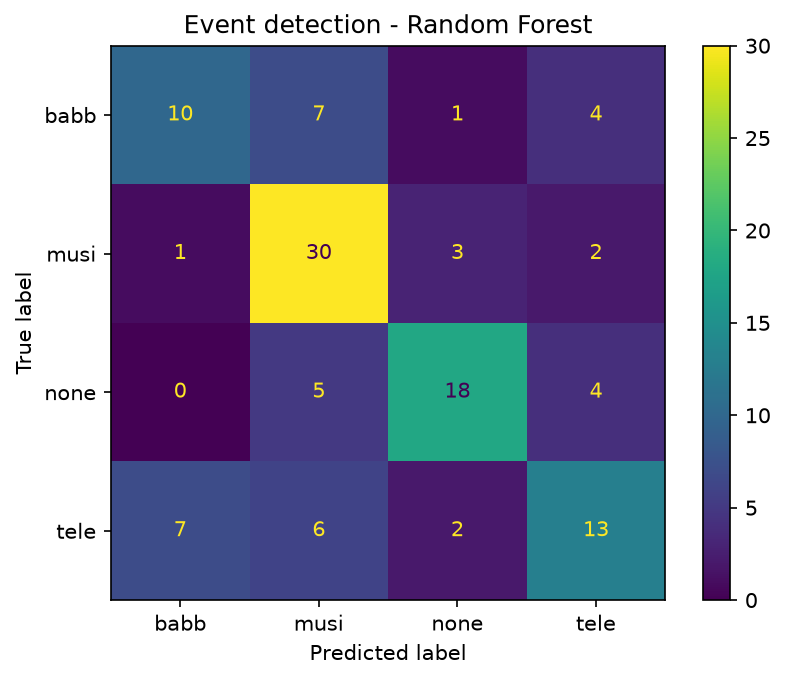
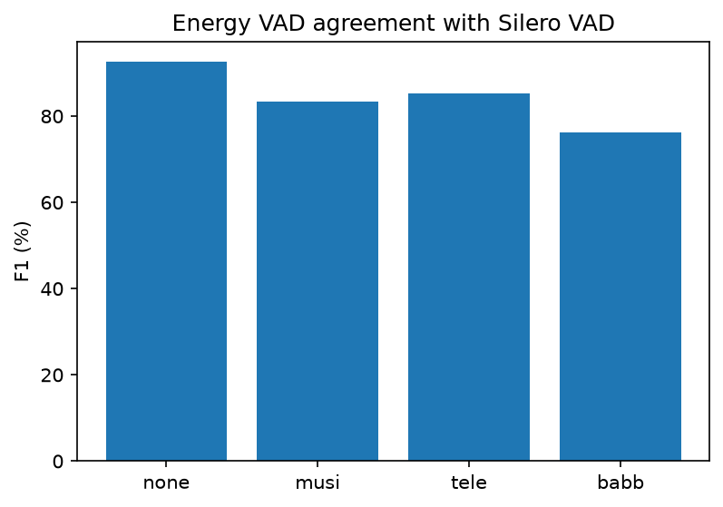
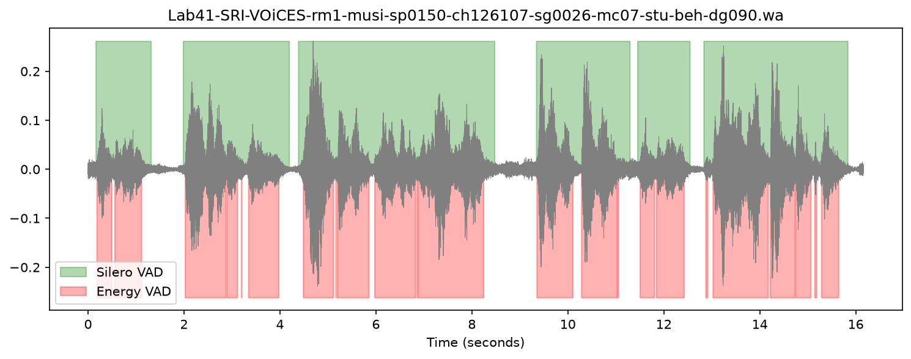

# Mini Task 08: Event Detection and VAD on VOiCES

## Dataset
A small part of the [VOiCES subset](https://github.com/Lab41/VOiCES-subset) (`VOiCES_90_1.tar`), as suggested for limited resources.
- **113 recordings**, 16 kHz, ~16 s each, **60 speakers**, foreground speaker at 90°.
- Recorded with distant microphones in real rooms (reverberation + background noise).
- The **distractor noise type** is encoded in each file name:

| Code | Meaning | Files |
|------|---------|-------|
| `none` | no distractor | 27 |
| `babb` | babble (many people talking) | 22 |
| `musi` | music | 36 |
| `tele` | television | 28 |

Note: files starting with `._` are macOS metadata files, not audio, and are skipped.

## Task 1: Event Detection

**Goal:** detect which background event (distractor) is present in a recording (4 classes).

**Method**
- Features: 20 MFCCs, mean and standard deviation over time → 40 features per file.
- 5-fold cross-validation **split by speaker** (`GroupKFold`), because the same sentence is recorded by several microphones; this prevents the model from seeing the same utterance in training and testing.
- Classifiers: KNN, SVM, Random Forest, Logistic Regression, Decision Tree.

**Results** (chance level ≈ 25%)

| Classifier | Accuracy |
|------------|----------|
| KNN | 52.1% ± 11.3 |
| SVM | 61.2% ± 8.1 |
| **Random Forest** | **63.0% ± 8.9** |
| Logistic Regression | 58.6% ± 10.0 |
| Decision Tree | 53.1% ± 2.2 |



**Observations**
- **Music** is the easiest class (30/36 correct) thanks to its tonal and rhythmic structure.
- **Television** and **babble** are the hardest and are often confused with each other and with music. This makes sense: TV audio itself contains speech and music.
- The task is difficult because the distractor is quieter than the main speaker and the recordings are far-field and reverberant.

## Task 2: Voice Activity Detection (VAD)

**Goal:** find the parts of each recording that contain speech.

**Method**
- The dataset has no human time labels for speech, so a pretrained neural VAD (**Silero VAD**) is used as the **reference**.
- Our system is a simple **energy-based VAD**: 25 ms frames (10 ms hop); a frame is speech if its energy is more than 8 dB above the noise floor (10th percentile of frame energies).
- Agreement is measured with **F1 on speech frames**, per distractor type.

**Results**

| Distractor | F1 vs Silero |
|------------|--------------|
| none | 92.5% |
| tele | 85.2% |
| musi | 83.3% |
| babb | 76.2% |




**Observations**
- Without distractor noise, the energy VAD agrees closely with Silero.
- **Babble is the hardest case**: background babble *is* speech, so its energy looks like the main speaker's.
- The energy VAD splits speech into many short pieces at small pauses between words, while Silero produces longer, continuous speech segments.

**Limitation:** Silero VAD is a strong model, but it is a reference, not human ground truth.

## Files
| File | Description |
|------|-------------|
| `explore_voices.py` | Count files and distractor types |
| `event_detection.py` | Event detection with 5 classifiers |
| `vad_voices.py` | Energy VAD vs Silero VAD |
| `event_confusion.png`, `vad_f1_by_noise.png`, `vad_example.png` | Result figures |

## How to run
```
pip install torch==2.8.0 torchaudio==2.8.0 soundfile matplotlib scikit-learn silero-vad
mkdir voices_data
tar -xf VOiCES_90_1.tar -C voices_data
python event_detection.py
python vad_voices.py
```