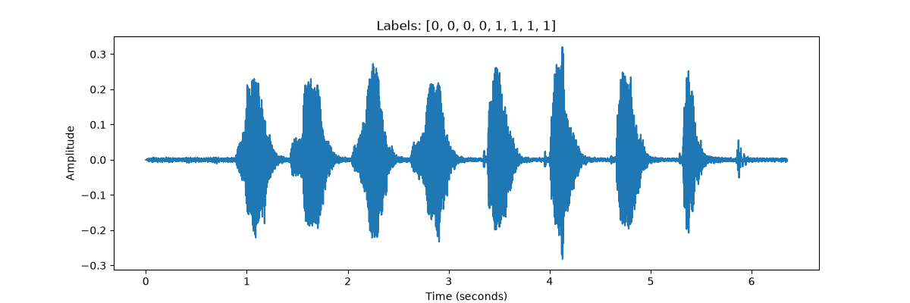
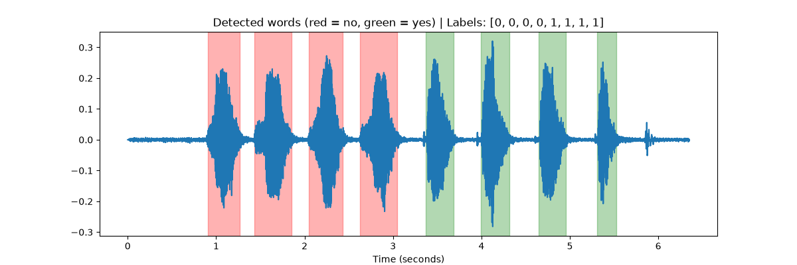
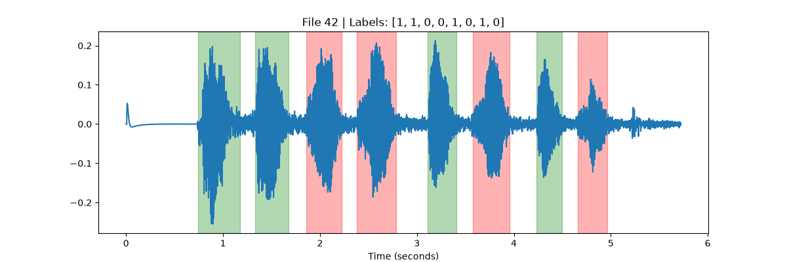
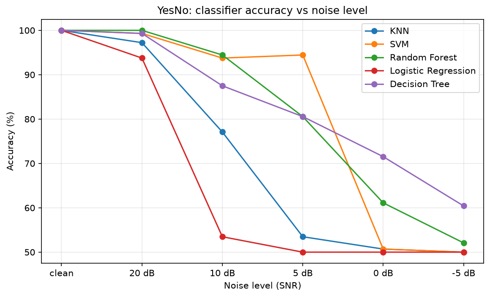

# Mini Task 08: Classifiers on the YesNo Dataset

## Goal
Train and compare different classifiers on the **YesNo** dataset from `torchaudio`.

## Dataset
- 60 recordings, 8 kHz, one speaker.
- Each recording contains **8 words**, each either "yes" (1) or "no" (0).
- Labels are a list of 8 values, e.g. `[0, 0, 0, 0, 1, 1, 1, 1]`.

## Method
1. **Word segmentation (energy-based VAD)** — `vad_utils.py`
   - Split the signal into 25 ms frames (10 ms hop) and compute RMS energy.
   - Frames above a threshold are speech; close segments are merged and very short ones removed.
   - Since every file has exactly 8 words, several thresholds are tried until 8 segments are found.
   - Result: **59 of 60** files were split correctly (file 21 was skipped) → **472 words**.
   
   
   
2. **Feature extraction**
   - 13 MFCCs per frame, then the **mean and standard deviation** over time → 26 features per word.
3. **Train/test split**
   - Split by **file** (70% / 30%), so test words come from recordings never seen in training.
   - Train: 328 words, Test: 144 words.
4. **Classifiers** (each with feature standardization)
   - KNN, SVM, Random Forest, Logistic Regression, Decision Tree.

## Results

### Clean audio
All five classifiers reached **100% accuracy**. The task is easy because there is a single speaker, clean recordings, and two acoustically very different words.

### Robustness to noise
To make the comparison meaningful, classifiers were trained on clean audio and tested with added white noise at different SNR levels (20, 10, 5, 0, -5 dB).



Observations (50% = random guessing, since there are only 2 classes):
- **Logistic Regression** and **KNN** degrade first and fall to chance level by 10 dB and 5 dB respectively.
- **SVM** stays very accurate down to 5 dB, then collapses.
- **Random Forest** degrades gradually and is among the best at moderate noise.
- **Decision Tree** keeps the highest accuracy under very strong noise (0 and -5 dB), but is still weak there.

**Conclusion:** all classifiers solve the clean task, but their robustness to noise differs a lot. SVM and Random Forest are the most robust at moderate noise levels.

## Files
| File | Description |
|------|-------------|
| `test_yesno.py` | Load the dataset and inspect one recording |
| `plot_yesno.py` | Plot the waveform of one recording |
| `vad_utils.py` | Energy-based word segmentation (VAD) |
| `segment_yesno.py` | Run segmentation on all files and visualize the result |
| `train_yesno.py` | Extract MFCC features and compare 5 classifiers |
| `noise_yesno.py` | Test classifier robustness under added noise |
| `noise_results.png` | Accuracy vs noise level plot |

## How to run
```
pip install torch==2.8.0 torchaudio==2.8.0 soundfile matplotlib scikit-learn
python train_yesno.py
python noise_yesno.py
```
